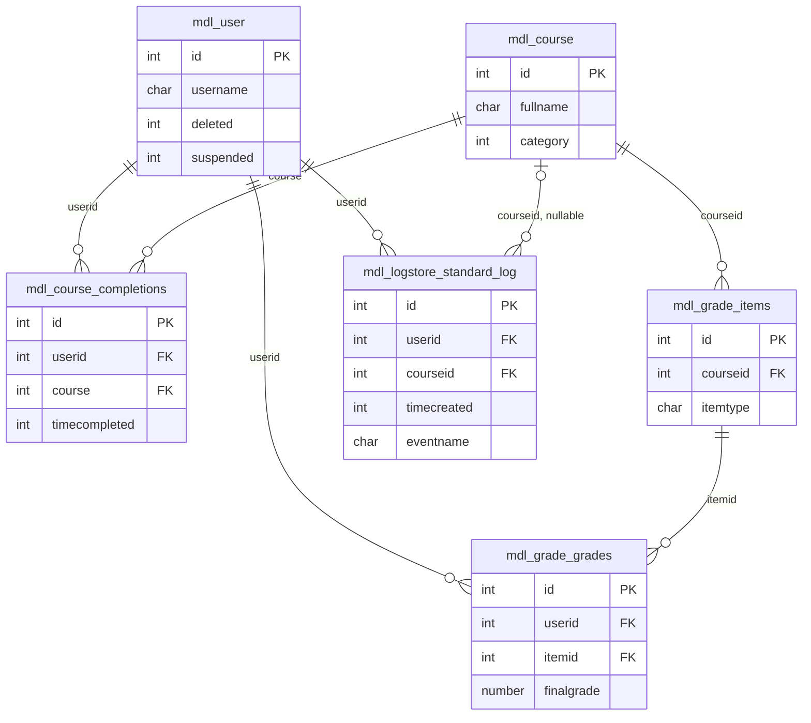

# Week 7 Day 2 — Moodle Core Table Schema and SQL Analysis

## Verification scope

The active checkout does not contain a root `config.php`, and its `public/config.php` only loads that missing file. Local MySQL 8.0 rejected an unauthenticated read-only connection (`ERROR 1045`); Docker Desktop's Linux engine was unavailable. Therefore no live `DESCRIBE` or data query could be run in this environment.

The definitions below are extracted from Moodle's checked-in XMLDB definitions: `public/lib/db/install.xml` and `public/admin/tool/log/store/standard/db/install.xml`. They report the XMLDB logical type, declared nullability/default, sequence flag, keys, and indexes; they are not server-specific MySQL `DESCRIBE` output. `—` means no explicit XMLDB default was declared; it does not assert SQL `NULL`.

## Table schemas

### `mdl_course`

`id` is the primary key. `originalcourseid` refers back to `course.id`; `category` identifies a course category. Course records are referenced by completion, grade-item, and standard-log rows.

| Column | XMLDB type | Null | XMLDB default | Key / note |
|---|---|---:|---|---|
| `id` | `int(10)` | NO | — | PK, sequence |
| `category` | `int(10)` | NO | `0` | Course category |
| `sortorder` | `int(10)` | NO | `0` | Index |
| `fullname` | `char(1333)` | NO | — | |
| `shortname` | `char(255)` | NO | — | Index |
| `idnumber` | `char(100)` | NO | — | Index |
| `summary` | `text` | YES | — | |
| `summaryformat` | `int(2)` | NO | `0` | |
| `format` | `char(21)` | NO | `topics` | |
| `showgrades` | `int(2)` | NO | `1` | |
| `newsitems` | `int(5)` | NO | `1` | |
| `startdate` | `int(10)` | NO | `0` | Unix timestamp |
| `enddate` | `int(10)` | NO | `0` | Unix timestamp |
| `relativedatesmode` | `int(1)` | NO | `0` | |
| `marker` | `int(10)` | NO | `0` | |
| `maxbytes` | `int(10)` | NO | `0` | |
| `legacyfiles` | `int(4)` | NO | `0` | |
| `showreports` | `int(4)` | NO | `0` | |
| `visible` | `int(1)` | NO | `1` | |
| `visibleold` | `int(1)` | NO | `1` | |
| `downloadcontent` | `int(1)` | YES | — | |
| `groupmode` | `int(4)` | NO | `0` | |
| `groupmodeforce` | `int(4)` | NO | `0` | |
| `defaultgroupingid` | `int(10)` | NO | `0` | |
| `lang` | `char(30)` | NO | — | |
| `calendartype` | `char(30)` | NO | — | |
| `theme` | `char(50)` | NO | — | |
| `timecreated` | `int(10)` | NO | `0` | Unix timestamp |
| `timemodified` | `int(10)` | NO | `0` | Unix timestamp |
| `requested` | `int(1)` | NO | `0` | |
| `enablecompletion` | `int(1)` | NO | `0` | |
| `completionnotify` | `int(1)` | NO | `0` | |
| `cacherev` | `int(10)` | NO | `0` | |
| `originalcourseid` | `int(10)` | YES | — | FK to `mdl_course.id` |
| `showactivitydates` | `int(1)` | NO | `1` | |
| `showcompletionconditions` | `int(1)` | YES | — | |
| `pdfexportfont` | `char(50)` | YES | — | |
| `enableaitools` | `int(1)` | YES | — | |
| `deletioninprogress` | `int(1)` | YES | — | |

Declared keys: `PRIMARY(id)`; `FOREIGN(originalcourseid) REFERENCES course(id)`. Indexes: `category`, `idnumber`, `shortname`, `sortorder` (non-unique).

### `mdl_grade_grades`

`id` is the primary key. `userid` links a grade to a user; `itemid` links to `mdl_grade_items.id`. The course is reached through `mdl_grade_items.courseid`, not by a direct course column on this table. The unique `(userid, itemid)` key permits one grade per user and item.

| Column | XMLDB type | Null | XMLDB default | Key / note |
|---|---|---:|---|---|
| `id` | `int(10)` | NO | — | PK, sequence |
| `itemid` | `int(10)` | NO | — | FK to `mdl_grade_items.id` |
| `userid` | `int(10)` | NO | — | FK to `mdl_user.id`; unique with `itemid` |
| `rawgrade` | `number(10,5)` | YES | — | |
| `rawgrademax` | `number(10,5)` | NO | `100` | |
| `rawgrademin` | `number(10,5)` | NO | `0` | |
| `rawscaleid` | `int(10)` | YES | — | FK to `scale.id` |
| `usermodified` | `int(10)` | YES | — | FK to `user.id` |
| `finalgrade` | `number(10,5)` | YES | — | Aggregated/final grade value |
| `hidden` | `int(10)` | NO | `0` | |
| `locked` | `int(10)` | NO | `0` | |
| `locktime` | `int(10)` | NO | `0` | Unix timestamp |
| `exported` | `int(10)` | NO | `0` | |
| `overridden` | `int(10)` | NO | `0` | |
| `excluded` | `int(10)` | NO | `0` | |
| `feedback` | `text` | YES | — | |
| `feedbackformat` | `int(10)` | NO | `0` | |
| `information` | `text` | YES | — | |
| `informationformat` | `int(10)` | NO | `0` | |
| `timecreated` | `int(10)` | YES | — | Unix timestamp |
| `timemodified` | `int(10)` | YES | — | Unix timestamp |
| `aggregationstatus` | `char(10)` | NO | `unknown` | |
| `aggregationweight` | `number(10,5)` | YES | — | |
| `deductedmark` | `number(10,5)` | NO | `0` | |

Declared keys: `PRIMARY(id)`; foreign keys `itemid`, `userid`, `rawscaleid`, `usermodified`; `UNIQUE(userid, itemid)`. Index: `(locked, locktime)` (non-unique).

### `mdl_course_completions`

`id` is the primary key. `userid` and `course` identify the user/course pair; their unique index enforces one row per pair. This XMLDB definition declares indexes for these relationship columns, but no foreign-key constraints for them. Importantly, this course-level table has `timecompleted`, not a `completionstate` column; a status can be derived from `timecompleted`. Module-level completion states are stored separately.

| Column | XMLDB type | Null | XMLDB default | Key / note |
|---|---|---:|---|---|
| `id` | `int(10)` | NO | — | PK, sequence |
| `userid` | `int(10)` | NO | `0` | Logical relationship to `mdl_user.id` |
| `course` | `int(10)` | NO | `0` | Logical relationship to `mdl_course.id` |
| `timeenrolled` | `int(10)` | NO | `0` | Unix timestamp |
| `timestarted` | `int(10)` | NO | `0` | Unix timestamp |
| `timecompleted` | `int(10)` | YES | — | Unix timestamp; NULL means not completed |
| `reaggregate` | `int(10)` | NO | `0` | |

Declared key: `PRIMARY(id)`. Indexes: `userid`, `course`, `timecompleted` (non-unique); `UNIQUE(userid, course)`.

### `mdl_user`

`id` is the primary key and the user identifier referenced by completion, grade, and log records. `username` is unique together with `mnethostid`; `deleted` and `suspended` support filtering inactive accounts.

| Column | XMLDB type | Null | XMLDB default | Key / note |
|---|---|---:|---|---|
| `id` | `int(10)` | NO | — | PK, sequence |
| `auth` | `char(20)` | NO | `manual` | |
| `confirmed` | `int(1)` | NO | `0` | |
| `policyagreed` | `int(1)` | NO | `0` | |
| `deleted` | `int(1)` | NO | `0` | |
| `suspended` | `int(1)` | NO | `0` | |
| `mnethostid` | `int(10)` | NO | `0` | Part of username unique key |
| `username` | `char(100)` | NO | — | Unique with `mnethostid` |
| `password` | `char(255)` | NO | — | Credential hash; do not expose in reports |
| `idnumber` | `char(255)` | NO | — | Index |
| `firstname` | `char(100)` | NO | — | Index |
| `lastname` | `char(100)` | NO | — | Index |
| `email` | `char(100)` | NO | — | Index |
| `emailstop` | `int(1)` | NO | `0` | |
| `phone1` | `char(20)` | NO | — | |
| `phone2` | `char(20)` | NO | — | |
| `institution` | `char(255)` | NO | — | |
| `department` | `char(255)` | NO | — | |
| `address` | `char(255)` | NO | — | |
| `city` | `char(120)` | NO | — | Index |
| `country` | `char(2)` | NO | — | Index |
| `lang` | `char(30)` | NO | `en` | |
| `calendartype` | `char(30)` | NO | `gregorian` | |
| `theme` | `char(50)` | NO | — | |
| `timezone` | `char(100)` | NO | `99` | |
| `firstaccess` | `int(10)` | NO | `0` | Unix timestamp |
| `lastaccess` | `int(10)` | NO | `0` | Unix timestamp; index |
| `lastlogin` | `int(10)` | NO | `0` | Unix timestamp |
| `currentlogin` | `int(10)` | NO | `0` | Unix timestamp |
| `lastip` | `char(45)` | NO | — | |
| `secret` | `char(15)` | NO | — | |
| `picture` | `int(10)` | NO | `0` | |
| `description` | `text` | YES | — | |
| `descriptionformat` | `int(2)` | NO | `1` | |
| `mailformat` | `int(1)` | NO | `1` | |
| `maildigest` | `int(1)` | NO | `0` | |
| `maildisplay` | `int(2)` | NO | `2` | |
| `autosubscribe` | `int(1)` | NO | `1` | |
| `trackforums` | `int(1)` | NO | `0` | |
| `timecreated` | `int(10)` | NO | `0` | Unix timestamp |
| `timemodified` | `int(10)` | NO | `0` | Unix timestamp |
| `trustbitmask` | `int(10)` | NO | `0` | |
| `imagealt` | `char(255)` | YES | — | |
| `lastnamephonetic` | `char(255)` | YES | — | Index |
| `firstnamephonetic` | `char(255)` | YES | — | Index |
| `middlename` | `char(255)` | YES | — | Index |
| `alternatename` | `char(255)` | YES | — | Index |

Declared key: `PRIMARY(id)`. Unique index: `(mnethostid, username)`. Other non-unique indexes: `deleted`, `confirmed`, `firstname`, `lastname`, `city`, `country`, `lastaccess`, `email`, `auth`, `idnumber`, `firstnamephonetic`, `lastnamephonetic`, `middlename`, `alternatename`.

### `mdl_logstore_standard_log` (modern standard log store)

This checkout defines the standard log table in the log-store plugin. The table is `mdl_logstore_standard_log`, not `mdl_log`. `id` is the primary key; `userid` and optional `courseid` connect an event to its actor and course. `timecreated` is a Unix timestamp. `itemid` is not a column in this log table; it is the grade-item relationship on `mdl_grade_grades`.

| Column | XMLDB type | Null | XMLDB default | Key / note |
|---|---|---:|---|---|
| `id` | `int(10)` | NO | — | PK, sequence |
| `eventname` | `char(255)` | NO | — | Event class name |
| `component` | `char(100)` | NO | — | |
| `action` | `char(100)` | NO | — | |
| `target` | `char(100)` | NO | — | |
| `objecttable` | `char(50)` | YES | — | |
| `objectid` | `int(10)` | YES | — | |
| `crud` | `char(1)` | NO | — | |
| `edulevel` | `int(1)` | NO | — | |
| `contextid` | `int(10)` | NO | — | FK to `context.id` |
| `contextlevel` | `int(10)` | NO | — | |
| `contextinstanceid` | `int(10)` | NO | — | |
| `userid` | `int(10)` | NO | — | FK to `user.id` |
| `courseid` | `int(10)` | YES | — | FK to `course.id` |
| `relateduserid` | `int(10)` | YES | — | FK to `user.id` |
| `anonymous` | `int(1)` | NO | `0` | |
| `other` | `text` | YES | — | |
| `timecreated` | `int(10)` | NO | — | Unix timestamp; index |
| `origin` | `char(10)` | YES | — | |
| `ip` | `char(45)` | YES | — | Personal data; omit unless needed |
| `realuserid` | `int(10)` | YES | — | FK to `user.id` |

Declared keys: `PRIMARY(id)`; foreign keys `contextid`, `userid`, `courseid`, `realuserid`, `relateduserid`. Indexes: `timecreated`; `(courseid, anonymous, timecreated)`; `(userid, contextlevel, contextinstanceid, crud, edulevel, timecreated)` (all non-unique).

## ER diagram

`mdl_grade_items` is shown as a bridge because `mdl_grade_grades` has `itemid`, while the course association is on `mdl_grade_items.courseid`. The completion table's course column is named `course`. The completion relationships are logical/application relationships in this XMLDB definition, not declared foreign-key constraints.



## SQL queries and execution results

All three queries below are prepared against the checked-in Moodle schema but **were not executed**: the local Moodle configuration is missing and the available MySQL login was rejected. The tables show result columns only, not invented sample rows. Re-run after configuring a Moodle database and attach actual output.

### (a) Active students, enrolled courses, and course completion

`mdl_course_completions` has no raw `completionstate` column. The query derives a course-level status from `timecompleted`. It filters to current active enrolments and users assigned the standard `student` role in the course context.

```sql
SELECT
    u.id AS userid,
    u.username,
    u.firstname,
    u.lastname,
    c.id AS courseid,
    c.fullname AS coursename,
    CASE
        WHEN cc.timecompleted IS NULL OR cc.timecompleted = 0 THEN 'incomplete'
        ELSE 'complete'
    END AS course_completion_status,
    cc.timecompleted,
    CASE
        WHEN cc.timecompleted IS NULL OR cc.timecompleted = 0 THEN NULL
        ELSE FROM_UNIXTIME(cc.timecompleted)
    END AS completed_at
FROM mdl_course_completions AS cc
JOIN mdl_user AS u ON u.id = cc.userid
JOIN mdl_course AS c ON c.id = cc.course
WHERE u.deleted = 0
  AND u.suspended = 0
  AND c.id <> 1
  AND EXISTS (
      SELECT 1
      FROM mdl_user_enrolments AS ue
      JOIN mdl_enrol AS e ON e.id = ue.enrolid
      WHERE ue.userid = u.id
        AND e.courseid = c.id
        AND ue.status = 0
        AND e.status = 0
        AND (ue.timestart = 0 OR ue.timestart <= UNIX_TIMESTAMP())
        AND (ue.timeend = 0 OR ue.timeend >= UNIX_TIMESTAMP())
  )
  AND EXISTS (
      SELECT 1
      FROM mdl_role_assignments AS ra
      JOIN mdl_context AS ctx ON ctx.id = ra.contextid
      JOIN mdl_role AS r ON r.id = ra.roleid
      WHERE ra.userid = u.id
        AND ctx.contextlevel = 50
        AND ctx.instanceid = c.id
        AND r.shortname = 'student'
  )
ORDER BY c.fullname, u.lastname, u.firstname
LIMIT 500;
```

**Execution status:** Not executed; database credentials/configuration unavailable.

| userid | username | firstname | lastname | courseid | coursename | course_completion_status | timecompleted | completed_at |
|---|---|---|---|---|---|---|---|---|
| No actual result rows available | | | | | | | | |

### (b) Average final course grade

The course-level grade item is selected with `itemtype = 'course'`, avoiding an average across every activity grade item. `COUNT` reports how many non-NULL final grades contribute to each average.

```sql
SELECT
    c.id AS courseid,
    c.fullname AS coursename,
    AVG(gg.finalgrade) AS average_final_grade,
    COUNT(gg.finalgrade) AS graded_user_count
FROM mdl_grade_grades AS gg
JOIN mdl_grade_items AS gi ON gi.id = gg.itemid
JOIN mdl_course AS c ON c.id = gi.courseid
JOIN mdl_user AS u ON u.id = gg.userid
WHERE gi.itemtype = 'course'
  AND gg.finalgrade IS NOT NULL
  AND u.deleted = 0
  AND u.suspended = 0
GROUP BY c.id, c.fullname
ORDER BY c.fullname;
```

**Execution status:** Not executed; database credentials/configuration unavailable.

| courseid | coursename | average_final_grade | graded_user_count |
|---|---|---|---|
| No actual result rows available | | | |

### (c) User logins and activity in the last seven days

This uses Moodle's modern standard log store. Login events are identifiable by `eventname`; the query also returns other recent user activity. The time range is bounded and results are capped to avoid an unbounded report.

```sql
SELECT
    l.id AS logid,
    l.timecreated,
    FROM_UNIXTIME(l.timecreated) AS occurred_at,
    l.eventname,
    l.component,
    l.action,
    l.target,
    l.userid,
    u.username,
    l.courseid
FROM mdl_logstore_standard_log AS l
JOIN mdl_user AS u ON u.id = l.userid
WHERE l.timecreated >= UNIX_TIMESTAMP() - (7 * 86400)
  AND l.userid > 0
  AND u.deleted = 0
ORDER BY l.timecreated DESC
LIMIT 500;
```

**Execution status:** Not executed; database credentials/configuration unavailable. `mdl_log` was not the standard-log table defined by this checkout.

| logid | timecreated | occurred_at | eventname | component | action | target | userid | username | courseid |
|---|---|---|---|---|---|---|---|---|---|
| No actual result rows available | | | | | | | | | |

## Re-run requirements

Provide a valid local Moodle `config.php` pointing to the intended database, then run the three queries and live `DESCRIBE` statements using an authorized MySQL/MariaDB client. Replace the result-status notes only with captured output; avoid including passwords, IP addresses, or unnecessary personal data in evidence.
